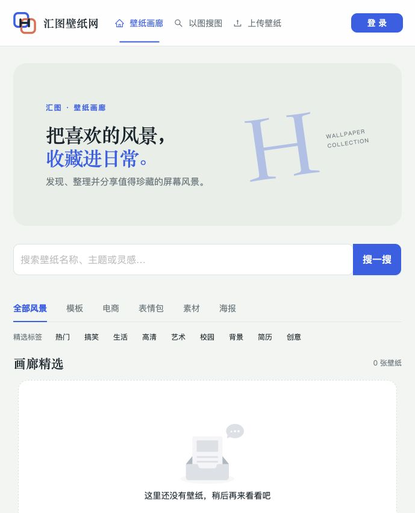
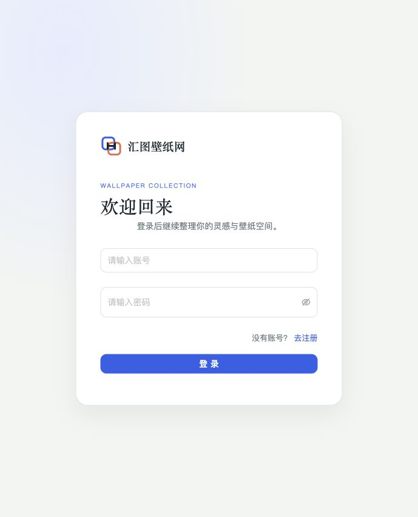

# 汇图壁纸网

**发现喜欢的壁纸，整理自己的灵感，与团队一起协作。**

汇图壁纸网是基于 Vue 3 和 Spring Boot 的图片管理应用，提供公开画廊、图片搜索、个人空间与团队协作功能。

[界面预览](#界面预览) · [功能介绍](#功能介绍) · [快速开始](#快速开始) · [配置说明](#配置说明) · [项目结构](#项目结构)

## 界面预览

**壁纸画廊** — 搜索、分类与标签筛选集中在首页。下图为当前画廊尚无壁纸时的真实界面。



**账号登录** — 登录后可以管理自己的图片与空间。



## 功能介绍

| 功能 | 说明 |
| --- | --- |
| 壁纸画廊 | 浏览公开图片，按关键词、分类和标签查找内容。 |
| 图片管理 | 上传、编辑图片信息，在空间中批量编辑图片。 |
| 视觉搜索 | 从已有图片发起以图搜图；空间图片支持按颜色搜索。 |
| 个人与团队空间 | 在空间中管理图片，团队空间支持成员及权限管理。 |
| 空间分析 | 查看空间容量和图片使用情况。 |
| 图片扩展 | 支持阿里云 AI 扩图；管理员可通过关键词批量抓取图片。 |

图片上传依赖腾讯云 COS；AI 扩图依赖阿里云百炼。批量抓取使用 Bing 图片搜索，以图搜图使用百度识图，两个功能均依赖相应外部服务和网络状态。

## 技术栈

| 部分 | 技术 |
| --- | --- |
| 前端 | Vue 3、TypeScript、Vite、Ant Design Vue、Pinia、ECharts |
| 后端 | Java 8、Spring Boot 2.7、MyBatis-Plus、WebSocket |
| 数据与存储 | MySQL、Redis、腾讯云 COS |
| 可选服务 | 阿里云百炼 AI 扩图 |
| 本地基础服务 | Docker Compose 运行 MySQL 和 Redis |

## 快速开始

以下步骤在项目根目录执行，适用于本地开发。前后端在本机运行，MySQL 和 Redis 在 Docker 容器中运行。

### 准备环境

- 安装并启动 Docker Desktop，或安装支持 Compose 的 Docker Engine。
- 安装 Conda 和 Maven。
- 准备 JDK 8、Node.js 和 npm。本工作区使用 `jdks/` 作为 Conda 环境，包含 JDK 8 和 Node.js 20；其他机器需自行准备可用环境，并调整下方路径。
- 准备腾讯云 COS 配置，以便上传图片；使用 AI 扩图时还需阿里云百炼 API Key。

### 1. 配置环境变量

在项目根目录创建 `.env`。如果已有该文件，检查字段即可，**不要覆盖现有密钥**。

```dotenv
DB_NAME=yu_picture
DB_USERNAME=root
DB_PASSWORD=请替换为本地数据库密码
DB_URL=jdbc:mysql://127.0.0.1:3306/yu_picture

REDIS_HOST=127.0.0.1
REDIS_PORT=6379

COS_HOST=
COS_SECRET_ID=
COS_SECRET_KEY=
COS_REGION=
COS_BUCKET=

ALIYUN_AI_API_KEY=
```

`.env` 随后会由 shell 加载，包含空格或 shell 特殊字符的值应正确引用或转义。不要将真实密钥提交到代码仓库。

### 2. 启动数据库和 Redis

```sh
docker compose up -d mysql redis
docker compose ps
```

首次创建 MySQL 数据卷时会执行 [初始化 SQL](yu-picture-backend/sql/create_table.sql)。请等待 MySQL 健康检查通过，再启动后端。

### 3. 启动后端

在项目根目录运行：

```sh
conda activate "$PWD/jdks"
set -a
source .env
set +a
export JAVA_HOME="$PWD/jdks"
export PATH="$JAVA_HOME/bin:$PATH"
cd yu-picture-backend
mvn spring-boot:run
```

后端默认地址为 `http://localhost:8123`，接口路径以 `/api` 开头。若使用其他 JDK 环境，请将 `JAVA_HOME` 改为对应的 JDK 8 路径。

### 4. 启动前端

打开另一个终端，从项目根目录运行：

```sh
conda activate "$PWD/jdks"
cd yu-picture-frontend
npm ci
npm run dev
```

在浏览器打开 Vite 输出的地址。默认端口为 `5173`；若已被占用，Vite 会选择其他端口。前端请求的后端地址位于 [request.ts](yu-picture-frontend/src/request.ts)，默认为 `http://localhost:8123`。

### 停止服务

在前端和后端终端分别按 `Ctrl+C`。在项目根目录停止基础服务：

```sh
docker compose stop
```

此命令保留 MySQL 和 Redis 数据卷。

## 配置说明

| 变量 | 用途 | 何时需要 |
| --- | --- | --- |
| `DB_NAME` | Compose 首次初始化的数据库名；当前 SQL 固定使用 `yu_picture` | 本地数据库 |
| `DB_USERNAME`、`DB_PASSWORD` | 后端数据库账号和密码；Compose 使用 `DB_PASSWORD` 设置 root 密码 | 本地数据库 |
| `DB_URL` | 后端 JDBC 连接地址 | 本地数据库 |
| `REDIS_HOST`、`REDIS_PORT` | Redis 地址和端口 | 会话及缓存 |
| `COS_HOST` | COS 存储桶访问域名 | 图片上传和存储 |
| `COS_SECRET_ID`、`COS_SECRET_KEY` | 腾讯云访问密钥 | 图片上传和存储 |
| `COS_REGION`、`COS_BUCKET` | 存储桶地域及带 APPID 的桶名称 | 图片上传和存储 |
| `ALIYUN_AI_API_KEY` | 阿里云百炼 API Key | 使用 AI 扩图时 |

- COS 地域、访问域名和密钥可参考[腾讯云 COS 文档](https://cloud.tencent.com/document/product/436/6224)及[访问密钥管理](https://cloud.tencent.com/document/product/598/40488)。
- 百炼 API Key 的获取方式见[阿里云官方说明](https://help.aliyun.com/zh/model-studio/get-api-key)。
- 如需改数据库名，应同步修改初始化 SQL、`DB_NAME` 和 `DB_URL`。已有 MySQL 数据卷不会重新执行初始化 SQL，也不会因为修改 `.env` 而自动更改原有数据库密码。

## 项目结构

```text
.
├── docker-compose.yml       MySQL 和 Redis 服务
├── docs/images/             README 界面截图
├── jdks/                    当前工作区的本地 Conda 环境
├── yu-picture-frontend/     Vue 前端
├── yu-picture-backend/      默认使用的 Spring Boot 后端
└── yu-picture-backend-ddd/  DDD 架构版本，不在上述默认启动流程中
```

## 开发与构建

下面的命令从项目根目录执行：

```sh
cd yu-picture-frontend
npm run type-check
npm run build
```

后端测试：

```sh
cd yu-picture-backend
mvn test
```

本项目基于 [yu-picture](https://github.com/liyupi/yu-picture) 开发。
